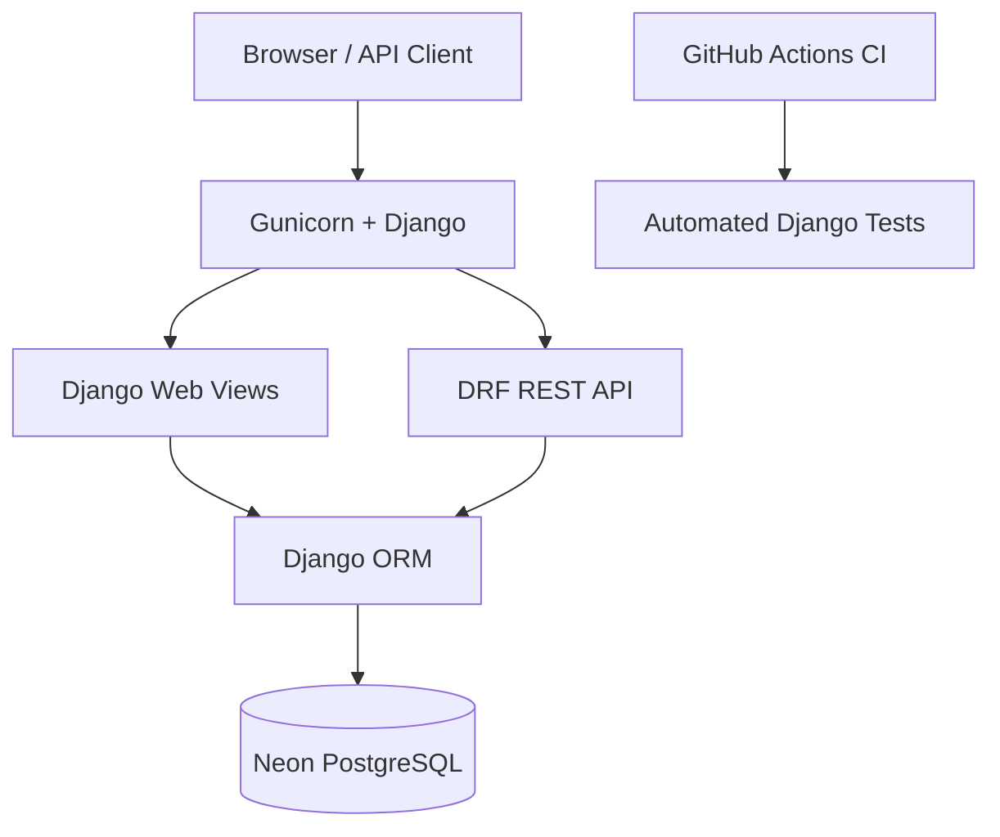

# Django Task Manager
[](https://github.com/yussufrakkabi/django-task-manager/actions/workflows/django-tests.yml)

A task management web application and REST API built with Django and Django REST Framework.

## Features

- User authentication
- Create, read, update, and delete tasks
- User-specific task management
- REST API endpoints
- Search, filtering, and pagination
- Swagger/OpenAPI documentation
- PostgreSQL database support
- Docker containerization
- Automated Django tests

## Tech Stack

- Python
- Django
- Django REST Framework
- PostgreSQL (Neon)
- Docker and Docker Compose
- Gunicorn
- WhiteNoise
- Git and GitHub


## Project Architecture

The application uses Django and Django REST Framework
to provide both a web interface and REST API.

### Components

- **Django:** Handles authentication, web views, and business logic.
- **Django REST Framework:** Provides API endpoints, serializers, and permissions.
- **PostgreSQL:** Stores users and tasks.
- **Docker:** Containerizes the application.
- **Gunicorn:** Runs the Django WSGI application.
- **WhiteNoise:** Serves static files.
- **Swagger/OpenAPI:** Documents API endpoints.
- **GitHub Actions:** Runs automated tests on pushes and pull requests.

### Architecture Diagram



### Security

- Authentication required for task operations.
- Users can access only their own tasks.
- Task ownership is assigned by the backend.
- Database credentials are stored in environment variables.
- Docker runs the application as a non-root user.


## API Endpoints

| Method | Endpoint | Description |
|--------|----------|-------------|
| GET | /tasks/api/viewset/tasks/ | List tasks |
| POST | /tasks/api/viewset/tasks/ | Create task |
| GET | /tasks/api/viewset/tasks/{id}/ | Retrieve task |
| PUT | /tasks/api/viewset/tasks/{id}/ | Update task |
| DELETE | /tasks/api/viewset/tasks/{id}/ | Delete task |
| GET | /tasks/api/docs/ | Swagger documentation |


## API Usage Examples

Base URL:

http://127.0.0.1:8000

### Authentication

Task endpoints require authentication.

For local development, log in through:

http://127.0.0.1:8000/users/login/

The application uses Django session authentication.

### List Tasks

GET /tasks/api/tasks/

Example response:

```json
[
  {
    "id": 1,
    "title": "Learn Django REST Framework",
    "description": "Practice API development",
    "completed": false,
    "owner": 1
  }
]
```

Only tasks belonging to the authenticated user are returned.

### Create Task

POST /tasks/api/tasks/

Request body:

```json
{
  "title": "Build REST API",
  "description": "Create Django API endpoints",
  "completed": false
}
```

Expected status: 201 Created

The backend automatically assigns the authenticated user
as the task owner.

### Retrieve Task

GET /tasks/api/tasks/1/

Expected status: 200 OK

### Update Task

PATCH /tasks/api/viewset/tasks/1/

Request body:

```json
{
  "completed": true
}
```

Expected status: 200 OK

### Delete Task

DELETE /tasks/api/viewset/tasks/1/

Expected status: 204 No Content

### Security

- Authentication is required for task operations.
- Users can access only their own tasks.
- Accessing another user's task returns 404.
- Task ownership is enforced by the backend.

### Interactive API Documentation

Swagger UI:

http://127.0.0.1:8000/tasks/api/docs/


## Run Locally with Docker

1. Clone the repository.
2. Create a `.env` file containing the required environment variables.
3. Start the application:

```bash
docker compose up -d --build
```

4. Apply database migrations:

```bash
docker compose exec web python manage.py migrate
```

5. Open http://127.0.0.1:8000/tasks/

## Run Tests

```bash
docker compose exec web python manage.py test tasks
```

## Security

- Environment variables for secrets
- Authentication and task ownership permissions
- Non-root Docker user
- Production security configuration

## Project Status

Backend development completed.
Public deployment is planned.


## Application Screenshots

### Task Dashboard


### Login Page


### Create Task


